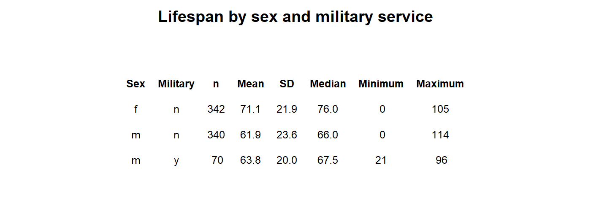
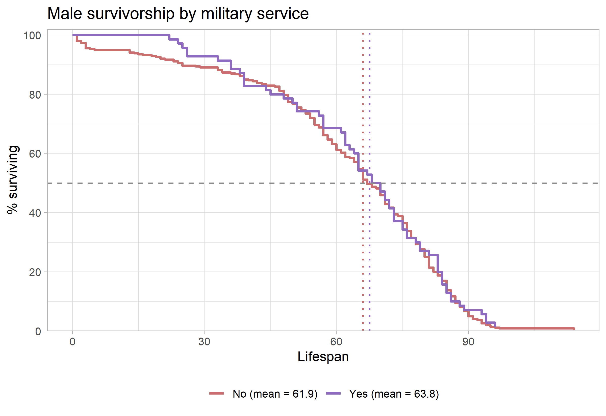

```{=latex}
\onecolumn
\begingroup
\thispagestyle{empty}
\sffamily

% Publication line and journal masthead
\noindent
\begin{minipage}[t]{0.66\linewidth}
  \scriptsize
  Larsen. \textit{Survivorship Curves of Sunset Hill Cemetery}
  \hfill (2026) 1:1\\
  Valdosta State University, Ecology and Evolution
\end{minipage}
\hfill
\begin{minipage}[t]{0.30\linewidth}
  \raggedleft
  \large Cemetery Demography\\[-2pt]
  \large BIOL 3250
\end{minipage}

\vspace{0.28in}

% Article-type band
\noindent
\colorbox{reportred}{%
  \parbox{\dimexpr\linewidth-2\fboxsep\relax}{%
    \color{white}
    \textbf{RESEARCH ARTICLE}\hfill
    \textbf{CLASS PROJECT}
  }%
}

\vspace{0.18in}

% Title and author line
\noindent
{\fontsize{23}{27}\selectfont
\textbf{The effect male military service on lifespan for those Buried at the Sunset Hill Cemetery, Valdosta, Georgia}\par}

\vspace{0.12in}

\noindent
{\small
Finnian Jake Larsen\textsuperscript{1,*}
}

\vspace{0.08in}

% Structured abstract
\setlength{\fboxsep}{6pt}
\noindent
\fcolorbox{reportred}{white}{%
  \begin{minipage}{\dimexpr\linewidth-2\fboxsep-2\fboxrule\relax}
    \small

    \textbf{Abstract}

    \vspace{3pt}

    \textbf{Purpose:}
    This project describes lifespan patterns in cemetery records and examines
    variation by sex and marital status. [you can do military service of males or pre- and post- a particular year - default 1930]

    \vspace{3pt}

    \textbf{Methods:}
    Recorded available birth and death information from gravestones
    and classified selected characteristics using evidence visible on the
    stones and in burial arrangements. [Go into much greater detail in the methods section]

    \vspace{3pt}

    \textbf{Results:}
    [Summarize the principal patterns in the class data.]

    \vspace{3pt}

    \textbf{Conclusions:}
    [State what the observed patterns suggest and note limitations. Distinguish
    lifespan in this cemetery sample from population life expectancy.]

    \vspace{3pt}

    \textbf{Keywords:}
    cemetery records; lifespan; survivorship; marital status; historical demography
  \end{minipage}%
}

% Bottom-page author and institutional details
\vfill

\noindent\rule{0.56\linewidth}{0.4pt}

\vspace{3pt}

\noindent
{\scriptsize
\textsuperscript{*}Correspondence: fjlarsen@valdosta.edu\\
\textsuperscript{1}Department of Biology, Valdosta State University,
Valdosta, Georgia, USA\\
Ecology and Evolution, BIOL 3250, Section B
}

\vspace{0.10in}

\noindent
\begin{minipage}[c]{0.20\linewidth}
  \includegraphics[width=0.72in]{Valdosta_State_University_seal.png}
\end{minipage}
\endgroup
\twocolumn
```

# Background

Cemetery records provide individual birth and death dates that can be used to describe lifespan among people represented in a burial ground. These records are a non-random sample: cemetery access, preservation of markers, migration, family burial practices, and the choice of graves to record may all affect which people appear in the dataset. The analyses below therefore describe the collected sample and should not be treated as direct estimates of lifespan for an entire town or historical population.

# Hypotheses

3. **Military service and lifespan:** I hypothesize that male records marked as military service will show shorter lifespans compared to records not marked for service because [Some buried service members will have died in combat, or have developed cancer, geriatric diseases, or other conditions that may have led to an early death.].

# Methods

Complete the prompts below. Replace bracketed text with details from the field visit and the final class dataset.

## Field site and sampling

- **Where did you go?** [Sunset Hill Semetary, Valdosta Georgia.]
- **What date and time of day did you collect records?** [October 14th, from 2:15PM to 3:00PM..]
- **What part of the cemetery did you sample?** [Samples were taken from around half of the semetary, surrounding the left most entrance.]
- **How did you choose graves?** [Sampling was mostly systematic with a few graves being missed due to damage, or visibility issues.]
- **How did you handle nearby graves and family plots?** [Most families were recorded all together. with a record kept of the relationship]

## Recorded information and variable definitions

- **What information did you record from each marker?** [Any information that indicated marital status, family relationships, military status, gender,  or other status indicaters were included.]
- **How was lifespan calculated?** [Life span was calculated from the difference between the date of death and the date of birth on the grave markers. Partial dates were not collected for the sample.]
- **How did you determine marital status?** [Marital status was recorded through evidence of explicit markings and infered through connected grave markers.]
- **How did you determine military service?** [Military status was determined through explicit markings and signs that stated military service and status, rank, or description of death.]
- **How did you determine sex or gender?** [Most sexual identity was infered thruough family relationships, feminine names or specific indicators.]
- **How were missing, illegible, or ambiguous records handled?** [Missing, illegible, or ambiguous records were not recorded for the dataset.]

## Dataset and analysis

- **How many records were collected by you?** [n = 32]
- **How many records were included in the final analysis?** [n = 753 ; This does not include tha graves missing partial information.]
- **Were records aggregated with the class dataset?** [Yes, records were aggregated with the class dataset, and duplicate entries were rmoved from the sampling.]
- **What summaries or plots were produced?** [Data recorded provided data and survivorship curves for the differneces in lifespan by gender, marital status, and male military service..]
- **What are the limits of the sample?** [This sample was limited for a number of reasons. Firstly, markers that contained incomplete datasets were not included. Secondondly,  only males were able to be compared for the sample, as no women who served were found in the survey. Lastly, many graves were missed due to time constraints of the sampling.]

# Results

The summary table in @fig-summary shows non-substantial differences in recorded lifespan by military status. Military Males had a mean lifespan of 67.5 years (SD = 20.0; n = 70), compared with 66.0 years (SD = 7.1; n = 3) for non-serving males. The marital-status breakdown is more tentative because there is only a small subgroup of malles served in the military. Also, most of the men that had served did not pass away while serving in action. Because these caveats affect the data, and the dataset is limited, they do not support broad conclusions about the lifespan of those who serve in the military.

{#fig-summary width=90% fig-pos="t"}

The sex-specific survivorship curves in @fig-sex show a different pattern: the plotted means are 67.5 years for males who served and 66.0 years for those who had not. The survivorship curve indicates that the lifespan of males who served and those who hd not similarly follow the same trend throughout both lifespans. The median markers indicate where each group’s observed curve reaches 50% surviving; they are distinct from the mean values shown in the legend.

{#fig-sex width=70% fig-pos="t"}

# Discussion

**Military Status and Effect on Lifespan** We did not find significant differences between military men and men not servicing in the military in respect to lifespan for our sample from the Sunset Hill cemetery in Valdosta, Georgia. Instead, we found, contrary to expectations of our hypothesis, that military men lived 2 years longer than non-military men. We believe this pattern can be explained in two ways; first, we did not get many individuals that died in war buried at the Sunset Hill cemetery, as many of those invidiuals were buried in Arlington, and secondly, we anticipated that military men, after having made it thorugh war, would exhibit similar life history trends as those not having served. Because we did not capture the death of youth service members, we instead get a very similar life history curve between both groups. 
However, we did hypothesize that men serving in the miliary may exhibit higher rates of cancer or geriatric diseases due to exposure to chemicals during basic training and service. While this could still be true, the life history table does not capture that effect. 

```{=latex}
\newpage
```

### References

::: {#refs} 
::: 
